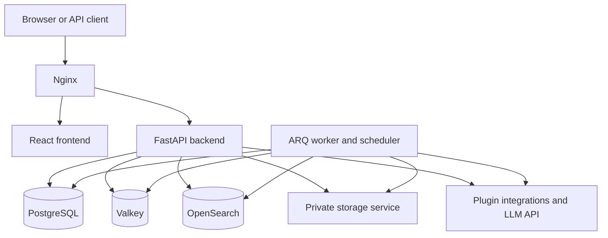

<!-- generated-by: gsd-doc-writer -->
# Architecture

## System Overview

IndraMesh Core is a PostgreSQL-backed asset-data platform with a React single-page application and
a layered FastAPI backend extended by trusted, in-process plugins. It accepts asset definitions,
object data, file uploads, queries, and task requests, and returns validated API responses and
background-job results; the Jira plugin adds bidirectional Jira Assets synchronization. Its
internal REST API is served under `/api/v1`; authenticated GraphQL is available under
`/api/v1/graphql` (outside production; in production the endpoint requires an active plugin that
declares `enables_http_graphql` — the `graphql-studio` plugin), and a separately authenticated
public API is mounted under `/public/api/v1`. The backend owns synchronous CRUD, authorization, AQL search,
and API serialization. An ARQ worker handles asynchronous sync, import/export, indexing, and
scheduled jobs. PostgreSQL is the source of record and runs the repository's own image (Apache AGE and
pgvector on the unchanged `postgres:18.4-alpine` base line), Valkey supplies caching and queueing,
OpenSearch supports search, and a private storage service persists object-file blobs.

## Component Diagram



- **Nginx** is the external entry point. It routes API and public API requests to the backend and
  all other requests to the frontend.
- **Frontend** is the React application in `frontend/src/`, organized by user-facing feature with
  shared components, hooks, and utilities.
- **Backend** is the FastAPI application in `backend/app/main.py`. It registers internal REST,
  public API, and conditional GraphQL routes, and initializes database, cache, search, encryption,
  and job-registry resources. Its process-local plugin registry supplies connector descriptors,
  plugin routes, hooks, and task declarations.
- **Worker** runs `app.worker_entry.WorkerSettings`. It consumes ARQ jobs and starts the
  APScheduler-backed schedule manager.
- **PostgreSQL** stores the asset hierarchy, users and permissions, tasks, audit data, and object
  file/comment metadata. Both install paths run the repository's own image, which carries the graph
  and vector extensions (Apache AGE and pgvector, compiled into the image from pinned sources) and
  bakes two server settings — `wal_level = logical` and a `shared_preload_libraries` list containing
  `age`. The extension objects themselves are created by the application's own migration chain
  (`alembic upgrade head`), in the application database only.
- **Valkey** provides the cache and ARQ broker — the Compose service and its volume carry the
  `valkey` name, and the application reads the connection URL from `VALKEY_URL` (the server's own
  password key is `VALKEY_PASSWORD`). The wire protocol keeps its historical `redis://` scheme and the client module keeps
  its `redis` name (`backend/app/db/redis.py`): those are protocol and library names, not service
  names.
- **OpenSearch** indexes schemas, object types, and objects for search and AQL's hybrid path. The
  backend and worker reach it through `OPENSEARCH_URL`, `OPENSEARCH_USERNAME` and
  `OPENSEARCH_PASSWORD`. The
  index is **derived state**: it is rebuilt from PostgreSQL through the existing reindex routes
  (`POST /api/v1/search/reindex/schema`, `POST /api/v1/search/reindex/all`), so no index data is
  migrated between stacks and the search volume starts empty on a fresh install. Compose and the
  cluster run the same group-readable wrapper image, built from one tracked Dockerfile.
- **Storage** is a private filesystem-backed FastAPI service in `app/storage_service/`. Only the
  backend and worker connect to it; clients access object files through the backend.
- **External integrations** include Jira Assets through `plugins/jira/`, and the provider-neutral
  LLM client in `backend/app/llm/` (`LLM_PROVIDER`/`LLM_MODEL`/`LLM_BASE_URL`/`LLM_API_KEY`/
  `LLM_MODE`). AI schema generation and AI translation suggestions are plugin-owned
  (`ai-schema-wizard`, `ai-translation`) and reach the client through the plugin SDK. Jira protocol
  and sync orchestration are plugin-owned, not native Core services.

## Data Flow

### Internal REST request

1. The browser sends a request through Nginx to `/api/v1`.
2. The FastAPI middleware stack applies CORS, rate limiting, security headers, proxy-header
   handling, request-size protection, exception handling, and request timing.
3. A router in `app/api/` authenticates the caller and applies type-level or record-level
   permission dependencies where required.
4. The route performs straightforward CRUD against an async SQLAlchemy session or delegates
   non-trivial work to `app/services/`.
5. The service reads or writes PostgreSQL, may use cache entries, and can enqueue longer work on
   Valkey for the worker.
6. FastAPI serializes the result through a Pydantic response schema and returns JSON through
   Nginx to the caller.

### Public API request

1. An external caller sends a bearer token to `/public/api/v1`.
2. `get_public_api_consumer` resolves the token to an `ApiClient` and its synthetic service user.
3. Public routers in `app/public_api/` use the same shared permission machinery and service layer
   as the internal API, while exposing only the public realm's routes.

### Object files and comments

1. Object-scoped routes in `app/api/objects.py` enforce record-level `objects:read` or
   `objects:update` access before reading or changing a file or comment.
2. `object_file_service.create_object_file()` streams an upload through the `StorageClient`
   protocol. The storage service writes a temporary file and atomically renames it into its
   filesystem shard; only then does the backend commit an `ObjectFile` metadata row.
3. Downloads stream the blob from storage through the backend without buffering the whole file.
   File deletion commits the metadata deletion before best-effort blob cleanup.
4. `object_comment_service.py` stores comments as `ObjectComment` rows in PostgreSQL. Both file
   and comment rows cascade when their Object is deleted. Jira pull reconciles remote attachments
   and comments through SDK media upserts and plugin-owned link tables; Core stores neutral
   `managed_by` provenance and guards externally managed records against native mutations.

### Background work

1. API routes and scheduled jobs enqueue work in Valkey.
2. The worker opens its own async database, cache, search, encryption, and scheduler resources.
3. Job functions in `app/worker.py` execute native imports, exports, indexing, and schedule
   dispatch. Native task types are `IMPORT`, `EXPORT`, and `REINDEX`.
4. Plugin tasks use the single ARQ entry point `run_plugin_task()`. It resolves the qualified
   task-type declaration in the worker's own registry, constructs a task-bound context, and invokes
   the declared runner through the active-state gate. Core owns task status, retry/failure handling,
   progress persistence, and post-run invalidation; plugin code owns the business engine.

### Plugin task admission and Jira synchronization

1. Core validates a task against `TaskTypeDeclaration`: parameter schema, required permission,
   scope requirements, schedulability, and the plugin's optional admission callback. The persisted
   task carries its original `creator_id`, service-account reference, and `plugin_parameters`.
2. The Jira plugin declares `jira.sync-pull` (Source-scoped) and `jira.sync-push`
   (Schema/Target-scoped) as schedulable; `jira.sync-export` is not schedulable.
3. `plugins/jira/pull.py` reads Jira via the plugin client and writes Core entities through
   `indramesh.sdk`. Plugin-owned links, checkpoints, baselines, and conflicts track reconciliation.
4. `plugins/jira/push.py` creates missing remote entities and pushes local changes while honoring
   link direction and same-instance checks. `plugins/jira/export.py` shares its create machinery
   but requires an empty remote destination and does not persist destination links or baselines.
5. The task context exposes only the task-bound service account's credentials. Core-data SDK
   writes derive the actor from the persisted task creator and retain native permission, audit,
   validation, cache, and indexing behavior.

## Key Abstractions

| Abstraction | Location | Purpose |
|---|---|---|
| FastAPI application | `backend/app/main.py` | Application lifecycle, middleware, router registration, and health/metrics routes. |
| Async persistence and CRUD schemas | `backend/app/db/__init__.py`, `backend/app/schemas/crud.py` | SQLAlchemy engine/session factory and Pydantic create/update/response contracts. |
| Authorization and public API consumer | `backend/app/services/auth_service.py`, `backend/app/models/api_client.py` | Role/record permission dependencies and public bearer-token resolution to a synthetic service user. |
| AQL pipeline | `backend/app/aql/` | Parses, resolves, compiles, and suggests the custom query language used for object search. |
| GraphQL API | `backend/app/graphql/` | Strawberry schema, authenticated context, resolvers, loaders, and response types. |
| Plugin lifecycle registry | `backend/app/plugin_system/registry.py` | `PluginRegistry` coordinates activation, capability calls, state reconciliation, and connector/task/database ownership registries. |
| Public plugin SDK | `backend/indramesh/sdk/__init__.py`, `backend/app/plugin_system/sdk.py` | `indramesh.sdk` exposes capability interfaces, declarations, typed Core-data operations, and task runtime helpers. |
| `StorageClient` | `backend/app/services/storage_client.py` | Protocol boundary for streaming blob store, fetch, and deletion operations. |
| Index outbox | `backend/app/models/index_outbox.py`, `backend/app/worker.py` | Durable record of OpenSearch work that allows delayed or retried indexing after a queue or worker failure. |
| Schedule manager | `backend/app/services/scheduler_manager.py` | Maps persistent schedules to ARQ-runnable functions using APScheduler and a SQLAlchemy job store. |

## Directory Structure Rationale

```text
backend/
  app/
    api/              # Internal REST routers
    public_api/       # Separately authenticated public REST and GraphQL realm
    graphql/          # Strawberry schema, resolvers, loaders, and types
    aql/              # AQL grammar, parser, resolver, compiler, and suggestions
    services/         # Business logic, integrations, authorization, cache, and scheduling
      connectors/     # Native connector interface and CSV implementation
    plugin_system/    # Discovery, lifecycle, SDK facade, hooks, and ownership registries
    storage_service/  # Private blob-storage ASGI application
    models/           # SQLAlchemy ORM entities and relationships
    schemas/          # Pydantic request and response models
    db/               # Database, cache, and search client lifecycles
    middleware/       # Request context/correlation, security headers, errors, cache-control, query profiling
    worker.py         # ARQ job implementations
  alembic/            # Database migrations
  indramesh/sdk/      # Public plugin-author import surface
plugins/
  example/            # Opt-in (active_by_default = false) extension-point demonstration
                      # Installed plugins land here as plugins/<name>/ (see Deployment Topology)
scripts/
  docker/, k8s/       # Installer, rebuild and update logic behind the root wrapper scripts
frontend/
  src/
    features/         # User-facing feature areas, including asset browsing
    shared/            # Reusable components, query hooks, and utilities
      plugin-runtime/ # Bundle loading, contribution registry, host adapters, and slots
nginx/
  nginx.conf          # Public reverse proxy and rate-limit configuration
deploy/
  helm/indramesh/     # Kubernetes Helm chart
docker-compose.yml    # Public Compose base (production-shaped) + maintenance profile
```

The five first-party plugins — `jira`, `graphql-studio`, `log-explorer`, `ai-schema-wizard` and
`ai-translation` — are published from their own repositories and installed into `plugins/<name>/`;
the README lists them.

The backend deliberately has no repository layer: simple routes query the ORM session directly,
while services encapsulate logic that crosses entities or infrastructure boundaries. The frontend
is feature-oriented so pages and their supporting UI stay together; code shared across features
lives under `shared/`.

## Asset Data Model

The core asset hierarchy is rooted at `Source` and `Schema`. A schema contains an ObjectType tree;
each ObjectType has Objects and ObjectTypeAttributes. Objects hold typed ObjectValues and may link
to other Objects through ObjectRefs. Statuses, imports, exports, and targets are schema-related
resources, while attribute and reference types define reusable field and relationship semantics.

`ObjectFile` and `ObjectComment` are object-scoped supporting records rather than separate roots.
`ObjectFile` stores its filename, content type, size, uploader, and generated storage key in
PostgreSQL; the associated bytes are private to the storage service. `ObjectComment` stores its
text and author metadata in PostgreSQL. Their externally managed provenance is connector-neutral:
Core stores `managed_by`, while Jira attachment/comment identifiers live in plugin link tables.

Classification is a per-instance **label catalogue**: `classification_families` (three seeded
system families — `confidentiality` single-valued and ranked, `personal_data` single-valued with one
fixed label, `export_control` multi-valued) and `classification_labels` (a stable `key`, an English
base `name`, a `position`, and a `family` FK), with German and operator names held in the generic
`translations` table under the `classification_label` translation type. Four assignment tables link
targets to labels: `schema_classification_labels`, `object_type_classification_labels`,
`object_type_attribute_classification_labels` and `object_classification_labels`. Each has a real FK
to the target with `ON DELETE CASCADE` and an FK to the label with `ON DELETE RESTRICT`, so deleting
a target drops its assignments while an assigned label cannot be deleted. For the single-valued
families a partial unique index enforces at most one label per target and family in PostgreSQL; the
multi-valued one has no such index. In 1.0.0 only the attribute and object tables are written (API
and the attribute editor); the Schema and ObjectType tables exist ahead of their surface and stay
empty. Classification is a marker only: no read path redacts, filters or logs on it, and the
effective classification along the hierarchy is documented but not computed.

Deletes follow the hierarchy through `ON DELETE CASCADE` foreign keys: removing a Source removes its
Schemas; removing a Schema removes its ObjectTypes and Objects; removing an ObjectType removes its
child ObjectTypes, ObjectTypeAttributes and Objects; removing an Object removes its ObjectValues,
ObjectRefs, files and comments. References that only point at a reusable or optional record use
`ON DELETE SET NULL` instead (an ObjectType's icon, a Schema's language, the user behind an audit
entry or a saved query), and an AttributeType that is still in use cannot be deleted
(`ON DELETE RESTRICT`).

Source `type` and Target `connector_type` are open string identities resolved by the connector
registry, not closed Jira-specific enums. Unknown or disabled connector identities remain readable;
writes use registry validation. Source and Target URLs and service-account credentials remain
Core-owned. Jira IDs, sync directions, cloud configuration, conflict strategy, and reconciliation
state belong to the Jira plugin. Core retains neutral ownership/write-protection markers and the
database-maintained `Source.source_url_revision` for stale-binding detection.

## Plugin Registry and Lifecycle

`backend/app/plugin_system/loader.py` discovers installed packages through the `indramesh.plugins`
entry-point group and directory plugins through `<name>/plugin.toml` in `INDRAMESH_PLUGINS_DIR`.
Manifest compatibility and capability inheritance are checked; a broken candidate is isolated
instead of aborting discovery of other plugins. Entry-point discovery precedes directory scanning,
and duplicate names are rejected rather than silently shadowing the first plugin.

Each backend and worker process builds its own `PluginRegistry`. Activation validates capability,
table-ownership, connector, and task declarations, gates database-owning plugins on their migration
head, calls `on_load()`, and transitions through `LOADED` to `ACTIVE`. Failures become `ERROR`;
persisted `DISABLED` state survives restart without calling `on_load()`. The kill switch persists
state and reconciles it across processes via Valkey/database checks; disabling preserves tables
and data. Worker-loaded snapshots let Core distinguish installed code from worker readiness.

`mounting.py` mounts plugin routers once at startup under `/api/v1/plugins/<name>`. Core prepends
authentication, `plugin-runtime:use`, and an active-state check; a disabled mounted route returns
503 instead of disappearing. Plugin-specific permission dependencies are additive. Plugin
administration uses the separate `plugins:read` and `plugins:manage` permissions.

Plugins import the public `indramesh.sdk` surface, not `app.*` internals. `PluginContext` supplies
the plugin's decrypted/defaulted configuration, logging, sessions, and task-bound progress,
credentials, outcomes, and invalidation requests. SDK Core-data calls commit independently, so
several calls are not one atomic transaction. Keyed creates and connector-media upserts support
replay-safe operations. Route calls supply the authenticated actor; task calls derive it from
`creator_id`. Hooks borrow the caller's transaction and cannot use SDK writes; they should schedule
work instead. These boundaries govern cooperative plugins, not hostile code: plugins execute
in-process with host access and are not sandboxed.

### Jira-owned persistence

`plugins/jira/database.py` has its own SQLAlchemy `DeclarativeBase` and metadata, separate from
Core models. `plugin.toml` declares its migration directory, `alembic_version_jira` version table,
and restricted-role requirement. Core validates names/ownership and migration readiness; the
plugin owns its `plugin_jira_*` schema and business semantics.

- `plugin_jira_connections` binds exactly one Source or Target, including endpoint configuration
  and conflict strategy; credentials remain in Core service-account records.
- Eight link tables bind schemas, object types, attributes, statuses, reference types, objects,
  comments, and attachments to source-bound connections of the same Source.
- Value and attribute sync-state tables retain comparison baselines; conflict, checkpoint, and
  sync-audit tables retain reconciliation decisions and progress.
- Connection/object-link URL-revision snapshots guard against reusing stale remote bindings
  after a Source URL changes. Plugin SQL manages plugin records; Core entity writes use the SDK.

## Frontend Plugin Contributions

`frontend/src/shared/plugin-runtime/PluginProvider.jsx` discovers active plugins through the
permission-gated `/api/v1/plugins/runtime` endpoint. `loader.js` fetches authenticated bundles from
`/api/v1/plugins/<name>/assets/<bundle>` and imports their default-export descriptors. The loader
checks manifest/descriptor family agreement; the registry identifies slot conflicts and the host
records load/render faults separately from backend lifecycle state. Host adapters share React,
router, query, and API facilities; plugin translations use host-assigned namespaces.

The host supports fifteen families (`registry.js` and `loader.js`); a plugin need not use all of
them. The Jira manifest currently declares eight of them.

| Family | Contribution | Conflict key |
|---|---|---|
| `pages` | Plugin page routes | `path` |
| `navItems` | Navigation entries | `id` |
| `attributeEditors` | Attribute-value editors | `data_type` |
| `actionButtons` | Object-type-matched actions | `id` |
| `settingsSections` | General settings sections | `id` |
| `taskForms` | Task-type parameter forms | `tasktype` |
| `connectorConfigEditors` | Connector-specific configuration UI | `connector_type` |
| `objectDetailSections` | Object detail sections | `id` |
| `schemaSettingsSections` | Schema settings sections | `id` |
| `objectTypeSettingsSections` | Object-type settings sections | `id` |
| `itemBadges` | Entity/list item badges | `id` |
| `schemaWizardEntries` | Entries beside templates/manual in the schema wizard | `id` |
| `translationPanelActions` | Field-level translation panel actions | `id` |
| `translationAdminActions` | UI-translation admin actions | `id` |
| `taskDetailActions` | Task-detail panel actions | `id` |

For keyed conflicts, the first registered entry wins and later entries are recorded as rejected.
Applicability requires a ready bundle and presence in the active runtime list; UI permissions
control visibility, while backend authorization remains authoritative.

## Deployment Topology

`docker-compose.yml` is the public, production-shaped base file. Its default-profile services are
PostgreSQL, Valkey, OpenSearch, backend, worker, storage, frontend and Nginx. The
backend and worker are dual-homed on the internal `storage_internal` network with storage; no
client-facing storage port is published. The log stack (Loki, Alloy and the read-only
`docker-socket-proxy`) is gated behind the `logging` and `observability` profiles and Grafana behind
`observability`, so none of it is a default workload. The one-shot `cutover` service is in the
`maintenance` profile. Two development-only concerns live in their own non-mirrored Compose files
rather than in the public base: the Jira integration in `docker-compose.jira.yml` and the
`e2e-tests` Playwright runner in `docker-compose.e2e.yml` (the `e2e` profile). The mirrored
`docker-compose.dev.yml` overlay carries the source bind mounts for local development.

Operators drive both topologies through root wrapper scripts that hand off to `scripts/docker/` and
`scripts/k8s/`: `install_indramesh_docker.sh` / `install_indramesh_k8s.sh` set up a stack (generated
`.env`, secrets, build, health wait) and are safe to re-run on a running stack — re-running the
Compose installer after checking out a new release is the Compose upgrade path.
`rebuild_indramesh_docker.sh` rebuilds and recreates selected Compose services after a source
change; `rebuild_indramesh_k8s.sh` builds and imports the images and runs one Helm upgrade against
the existing release, and `install_indramesh_k8s.sh && rebuild_indramesh_k8s.sh` is the k3s upgrade
path (see DEPLOYMENT.md, "Upgrading to a New Release"). `install_plugin_docker.sh` /
`install_plugin_k8s.sh` install a plugin from its repository and restart backend and worker. `./start` and `./stop` start and stop the
k3s stack only; a Compose stack uses `docker compose stop` and `docker compose up -d`.

`deploy/helm/indramesh/` describes the corresponding Kubernetes topology. PostgreSQL, Valkey,
OpenSearch, and storage use persistent StatefulSets; backend, worker, frontend, and Nginx run
as application workloads. The chart also includes migration, ingress/route, network-policy,
backup, and monitoring resources.
